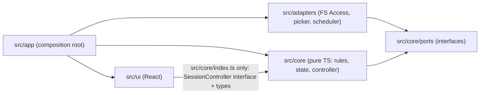
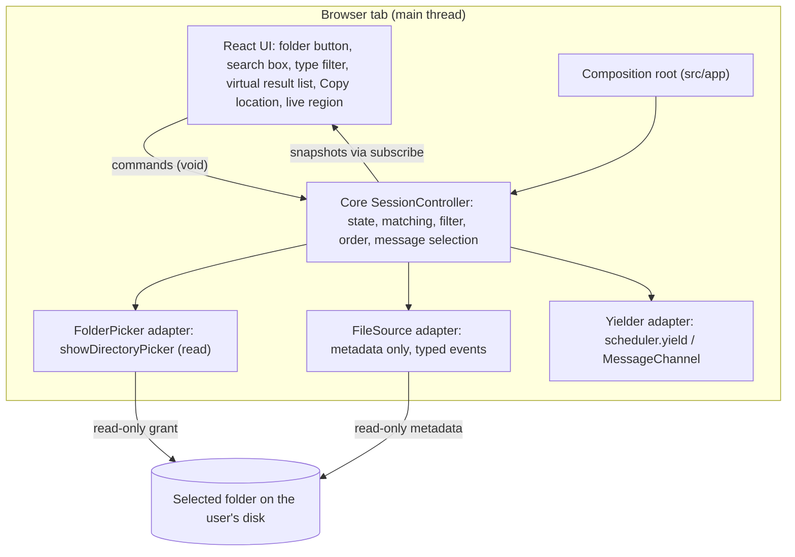
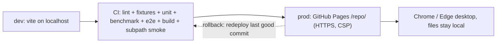

# Architecture Spine: Find

## Design Paradigm

**Hexagonal (ports and adapters), on a single main thread.**
- The **core** is pure TypeScript. It holds every product rule: matching, filtering, result order, session state, and message selection.
- The core exposes one **`SessionController` interface** and the shared types, through `src/core/index.ts`.
- The core defines **ports** for everything it needs from the outside world. **Adapters** implement them with browser APIs.
- The **React UI** is a driving adapter. It calls controller commands and renders the snapshots the controller publishes.
- `src/app/` is the composition root. It wires adapters into the core and hands the controller to the UI.

There is no Web Worker in the MVP (AD-5). Listing is cooperative (AD-7).

| Layer | Directory | May import |
| --- | --- | --- |
| Core (rules, state, controller, ports, shared types) | `src/core/` (ports in `src/core/ports/`) | nothing outside `src/core/` |
| Adapters (browser APIs) | `src/adapters/` | `src/core/ports/` only (it re-exports every type an adapter needs) |
| Composition root | `src/app/` | `src/core/`, `src/adapters/`, `src/ui/` |
| UI (React) | `src/ui/` | the public entry `src/core/index.ts` only (types and the `SessionController` interface) |



## Invariants & Rules

### AD-1 — Greenfield: no existing code to preserve [ADOPTED]

- **Binds:** all
- **Prevents:** builders importing, bundling, or "ratifying" non-code repository content as if it were an existing codebase.
- **Rule:** The repository had no application code when this spine was written (only planning documents, agent instructions, and BMAD tooling). All application code lives under `src/`, with tests and configuration at the repository root. The app never imports, bundles, or reads `_bmad/`, `_bmad-output/`, `.claude/`, or `docs/`. When the first build and test commands exist, `AGENTS.md` ("Running and verifying") is updated with them.

### AD-2 — Hexagonal layering and dependency direction [ADOPTED]

- **Binds:** all; NFR-8
- **Prevents:** product rules leaking into React components or browser adapters, and adapters depending on each other.
- **Rule:**
  - Imports follow only the table and diagram in *Design Paradigm*.
  - Adapters import only `src/core/ports/`, and never other adapters, the UI, `src/app/`, or other core modules.
  - The UI imports only `src/core/index.ts`, never `src/adapters/`, core internals, or a concrete controller class.
  - Only `src/app/` wires adapters to ports.
  - The rule is enforced by `eslint-plugin-boundaries` (see *Stack*). CI includes a lint fixture that deliberately violates it and must fail.
  - There are no exceptions. The former PDF-preview exception (AD-21) is retired.

### AD-3 — The core is pure TypeScript [ADOPTED]

- **Binds:** `src/core/`; NFR-8
- **Prevents:** browser or React APIs creeping into the core and making the rules untestable in Node.
- **Rule:** `src/core/` compiles under its own `tsconfig` with no `DOM` or `WebWorker` lib. It may not import `react` or any module outside `src/core/`. Picking, listing, and yielding reach the core only through ports. Browser handles appear in the core only as an opaque `DirectoryRef` type. Core unit tests run in Node under Vitest.

### AD-4 — Ports owned by the core, with typed events [ADOPTED]

- **Binds:** FR-1, FR-2, FR-4, FR-6, FR-8, FR-12, FR-15
- **Prevents:** browser-specific logic or untyped browser errors spreading into the core.
- **Revision:** 2026-10-25, review fixes. Picker port added; FileSource events typed.
- **Rule:** The core defines and owns these ports:
  - **FolderPicker:**
    - `isSupported(): boolean`.
    - `pick(): Promise<{ kind: 'granted', ref: DirectoryRef, name: string } | { kind: 'notOpened' }>`.
    - A cancelled picker and a blocked folder both return `notOpened` (PRD FR-2).
  - **FileSource:** `list(ref): AsyncIterable<FileSourceEvent>`, where `FileSourceEvent` is one of:
    - `{ kind: 'entry', name, location, modified: number | 'unavailable' }`;
    - `{ kind: 'folderUnreadable', location }`;
    - `{ kind: 'accessLost' }`.
  - **Yielder:** a real task yield.

  More rules:
  - The adapters translate every browser error into one of these results. No browser exception reaches the core.
  - A failed `getFile()` gives `modified: 'unavailable'` and never stops listing.
  - FileSource reads metadata only: it never reads a file's contents.
  - It includes hidden files and folders, and skips only `.DS_Store`, `Thumbs.db`, and `desktop.ini` (PRD Glossary *Listing*).
  - The TextExtractor port and the Clock port are not part of the MVP. They return with deferred features as new ports.
  - **Error mapping** (all in the adapters):

    | Browser outcome | Port result |
    | --- | --- |
    | Picker `AbortError` (cancel or blocked folder) | `{ kind: 'notOpened' }` |
    | Root directory `NotAllowedError`, `NotFoundError`, or `SecurityError` during listing | `accessLost` |
    | Subfolder iteration throws | `folderUnreadable` for that folder, then continue |
    | `getFile()` throws for an entry | `entry` with `modified: 'unavailable'` |
    | No `showDirectoryPicker` on `window` | `isSupported()` returns `false` |

### AD-5 — One session controller owns the session, behind an interface [ADOPTED]

- **Binds:** FR-3, FR-8, FR-9, FR-12, FR-15, FR-17; NFR-4
- **Prevents:** duplicated file lists, two components computing results differently, and a worker fallback rippling into the UI.
- **Revision:** 2026-10-25, scope reduction (main thread) and review fixes (interface seal).
- **Rule:**
  - Exactly one session controller per page holds all session data and computes all matching, filtering, and ordering.
  - The UI depends only on the `SessionController` interface (AD-9), never on its implementation.
  - There is no Web Worker in the MVP (decision D1, recorded in `_bmad-output/planning-artifacts/architecture/architecture-file-brwsr-2026-10-25/.memlog.md`), **conditional on spike S3**. If S3 fails, the same core runs in one dedicated worker behind a proxy that implements `SessionController`. That change touches `src/app/` and one adapter only, and **neither the UI nor the core's rules change**. In that fallback, the proxy calls `FolderPicker.pick()` on the main thread, inside the user's click, and passes the granted handle to the worker. A worker can't open the picker. [O-1]

### AD-6 — Folder handle and file hand-off [RETIRED]

- **Binds:** none (retired 2026-10-25)
- **Prevents:** reuse of this ID.
- **Rule:** Retired with the engine worker. The granted handle stays inside the picker and FileSource adapters, as a `DirectoryRef`. There is no file hand-off, because previews and open-in-tab are deferred. The ID is never reused.

### AD-7 — Cooperative listing and snapshot pacing [ADOPTED]

- **Binds:** FR-1, FR-15; NFR-4
- **Prevents:** listing freezing the page, keystroke results being delayed, and builders mistaking an `await` for a yield.
- **Revision:** 2026-10-25, scope reduction and review fixes (pacing split, standing performance tests).
- **Rule:**
  - **Yielding:**
    - Listing never runs more than about 20 ms of work without yielding through the Yielder [ASSUMPTION: 20 ms, tuned by S3]. The Yielder uses `scheduler.yield()`, with a `MessageChannel` fallback.
    - Awaiting an already-resolved promise is not a yield.
  - **Pacing:**
    - Snapshots caused by a **command** (`selectFolder`, `setQuery`, `setTypeFilter`, `clearFilters`) are published **synchronously**, before the command returns.
    - Snapshots caused **only by newly listed entries** are batched to at most about 10 per second. The transition out of `running` is published immediately.
    - The UI never debounces input.
  - Matching, filtering, and ordering are synchronous in-memory work, bounded by the 50,000-entry cap.
  - **Standing checks in CI:**
    - A Vitest benchmark asserts that matching, filtering, and ordering 50,000 fixture entries takes at most 50 ms per query on CI [ASSUMPTION].
    - Playwright tests listing 10,000 and 50,000 stubbed entries assert that no long task exceeds 100 ms (PRD NFR-4).
  - Newly listed entries are merged into the existing ordered results (binary insertion or a merge of a sorted batch). The full list is never re-sorted per batch.

### AD-8 — Generation guard [ADOPTED]

- **Binds:** FR-1, FR-2, FR-3, FR-15
- **Prevents:** entries from a previous folder leaking into a new session, and a cancelled picker disturbing the current session.
- **Revision:** 2026-10-25, review fixes (when to increment, check after every await, single guarded write).
- **Rule:**
  - `generation` increments **only** when `FolderPicker.pick()` returns `granted`, and a granted pick also sets `hint: 'none'`.
  - A `notOpened` result sets `hint: 'folderNotOpened'` and changes nothing else. If a session is open, it keeps its entries, query, filter, and results, and the UI shows the hint above them (PRD FR-2, decision CF-10).
  - On a new generation, the controller clears the entries, the query, the type filter, and the unreadable-folder count (FR-3), and cancels any pending batched-snapshot timer.
  - Listing code compares its captured generation with the current one **after every `await`**. Entries are added only through one method, `addEntries(generation, events)`, which ignores stale generations.
  - Search is synchronous, so no query IDs exist. The worker message protocol and its IDs remain retired.

### AD-9 — Single writer: the `SessionController` contract [ADOPTED]

- **Binds:** all session state; FR-12, FR-15, FR-17
- **Prevents:** state changing outside the core, two owners of one value, and mismatched snapshot shapes.
- **Revision:** 2026-10-25, review fixes (interface, one snapshot type, the filter lives in state).
- **Rule:** `src/core/index.ts` exports exactly this contract, and no other component defines its own version of it:

  ```ts
  type FileType = 'text' | 'pdf' | 'image' | 'other';
  interface FileEntry { id: string; name: string; location: string; type: FileType; modified: number | 'unavailable'; }
  type Listing = 'idle' | 'running' | 'completed' | 'capped' | 'stopped';
  type Primary = 'start' | 'unsupported' | 'prompt' | 'results' | 'emptyFolder' | 'filtersHideAll'
               | 'stillSearching' | 'noMatchCapped' | 'noMatchPartial' | 'noMatchFinal';
  interface SessionSnapshot {
    generation: number; seq: number;
    folderName: string | null; hint: 'none' | 'folderNotOpened';
    listing: Listing; entriesListed: number; foldersUnreadable: number;
    query: string; typeFilter: ReadonlySet<FileType>;
    results: readonly FileEntry[]; filtersHidden: number;
    stillUpdating: boolean; primary: Primary;
  }
  interface SessionController {
    getSnapshot(): SessionSnapshot;
    subscribe(listener: () => void): () => void;
    selectFolder(): void; setQuery(text: string): void;
    setTypeFilter(types: ReadonlySet<FileType>): void; clearFilters(): void;
  }
  ```

  - Commands return `void`. State is read only through `getSnapshot()` and `subscribe()`.
  - Listeners never call a command synchronously from inside a notification. In development and test builds, every published snapshot, its `results` array, and each `FileEntry` are frozen (`Object.freeze`).
  - Each snapshot is immutable and increments `seq`. `getSnapshot()` returns the same object until the next publish, which makes it compatible with React's `useSyncExternalStore`.
  - **Filter semantics:** an empty `typeFilter` set means no filter. `setTypeFilter` always receives the whole set. `clearFilters()` empties it.
  - **The picker and the click:** `selectFolder()` must call `FolderPicker.pick()` synchronously, before any `await`, so the browser's user-click requirement is preserved. The UI calls `selectFolder()` only from a click or key handler (PRD FR-1).

### AD-10 — A file entry's ID is its location [ADOPTED]

- **Binds:** FR-6, FR-8, FR-21
- **Prevents:** rendering keys, ordering, and Copy location using different identifiers.
- **Rule:** `FileEntry.id` is the location: the path from the selected folder's name, joined with `/`, with letter case as the browser reports it (for example `MyFiles/Clients/Acme/report.pdf`). It is the React key, the final ordering tiebreak, and the text Copy location copies.

### AD-11 — Message selection lives in the core [ADOPTED]

- **Binds:** FR-2, FR-4, FR-12, FR-15; EARS-03, EARS-04
- **Prevents:** the EARS-03 and EARS-04 logic, or the new notices, being re-implemented differently in UI components.
- **Revision:** 2026-10-25, review fixes (cap, unreadable folders, empty folder, start states).
- **Revision:** 2026-10-26, decision NC-C (rule 8 added; former rules 8–10 are now 9–11).
- **Rule:** One pure core function sets `primary`. The first rule that applies wins:
  1. Folder access is unsupported → `unsupported`.
  2. No session (none yet, or listing `stopped` because access was lost) → `start`.
  3. Listing is `completed` with 0 entries and `foldersUnreadable === 0` → `emptyFolder`.
  4. Empty query and no filter → `prompt`.
  5. Any visible results → `results`.
  6. `filtersHidden > 0` → `filtersHideAll`.
  7. Listing is `running` → `stillSearching` (EARS-04 rev. 1 when the query is non-empty; with an empty query and an active filter, the same key covers "no file entry has been listed yet").
  8. The query is empty → `prompt`. With an empty query, Find never shows a "no matching files" message. The cap and unreadable notices stay visible (decision NC-C).
  9. Listing is `capped` → `noMatchCapped`.
  10. Listing is `completed` and `foldersUnreadable > 0` → `noMatchPartial` (its text has no count; the count is shown only in the unreadable notice).
  11. Otherwise → `noMatchFinal` (EARS-03 rev. 3).

  More rules:
  - `stillUpdating` is `listing === 'running'`.
  - **Notices** shown alongside `primary`, independent of it:
    - the filter notice, when `filtersHidden > 0`;
    - the cap notice, when `listing === 'capped'`;
    - the unreadable notice, when `foldersUnreadable > 0`.
  - **Counting `filtersHidden`:**
    - with a query, the name matches excluded by the filter;
    - with an empty query, the entries excluded by the filter, and the notice text says "files" rather than "matches" (PRD FR-12).
  - The UI maps each key to the exact PRD text and never decides which message applies.

### AD-12 — The UI owns only view state [ADOPTED]

- **Binds:** `src/ui/`; FR-8, FR-15, FR-17
- **Prevents:** UI-side caches, filters, sorts, or query copies drifting from the controller.
- **Revision:** 2026-10-25, review fixes (query and filter come from the snapshot; scroll anchoring).
- **Rule:**
  - The search box is controlled by `snapshot.query`, and the filter checkboxes by `snapshot.typeFilter`.
  - The UI holds only:
    - the scroll position;
    - keyboard focus;
    - transient feedback, such as the "copied" confirmation.
  - Results, order, counts, notices, and `primary` come only from snapshots. The UI never filters, sorts, or matches.
  - The result list renders virtually: only the visible rows are drawn.
  - When new results arrive while listing runs, the list keeps the top visible row's `id` anchored in place (PRD FR-15). A Playwright test asserts that the anchored row doesn't move while a paused fake listing resumes.
  - Rows display `location` exactly as given. The UI never splits, joins, or rebuilds paths.
  - The hint (`snapshot.hint`) is shown above the results when a session is open, and in the start state otherwise.

### AD-13 — Error model [ADOPTED]

- **Binds:** FR-2, FR-4, FR-6, FR-12; NFR-4
- **Prevents:** one unreadable item stopping listing or vanishing silently, and builders reporting failures differently.
- **Revision:** 2026-10-25, review fixes (typed events, cap and unreadable become states).
- **Rule:**
  - **Entry-level:** an unreadable modified date is kept as `'unavailable'` on the entry. An unreadable subfolder increments `foldersUnreadable`. Listing continues in both cases.
  - **Cap:** at 50,000 entries, listing ends as `capped`. It is a state, not an error.
  - **Session-level:**
    - `accessLost` ends listing as `stopped` and returns to the start state, with `hint: 'folderNotOpened'` (PRD FR-12, FR-2).
    - An unsupported browser yields `primary: 'unsupported'`.
  - **Copy location failure:** if the clipboard write is rejected, the UI shows "Couldn't copy. Select and copy the location manually." [ASSUMPTION: wording]
  - No other error paths exist in the MVP.

### AD-14 — No network after load [ADOPTED]

- **Binds:** NFR-1
- **Prevents:** any code, dependency, or build default making network requests or being blocked by the CSP.
- **Revision:** 2026-10-25, review fixes (no inlined `data:` assets).
- **Rule:**
  - The production `index.html` sets a Content Security Policy with:
    - `default-src 'self'`
    - `connect-src 'none'`
    - `object-src 'none'`
    - `script-src 'self'`
    - `img-src 'self'`
    - `style-src 'self'`
  - No CDN or remote asset is used. `data:` is never added to the CSP.
  - The build sets `build.assetsInlineLimit: 0`, so Vite never inlines assets as `data:` URIs.
  - No code, including the virtual list, injects `<style>` elements or sets `style.cssText`. Styles come from bundled CSS files or individual `element.style` properties only.
  - **"Load" ends at app-ready**, the moment the start state is shown. Every script and asset is fetched before app-ready, and there are no lazy-loaded chunks after it.
  - The CSP is applied to the production build only, because the Vite dev server needs a live connection for hot reload. All CSP and network checks run against the production build.
  - **Checks:**
    - **CSP present:** a build-output test asserts that `dist/index.html` contains the CSP meta tag with `connect-src 'none'`, before any script.
    - **No inlined assets:** the same build test asserts that `dist/` contains no `data:` URLs.
    - **CSP enforced:** a Playwright test on the production build calls `fetch` to an external URL and to a same-origin URL after app-ready. Both must be rejected, and a `securitypolicyviolation` event must fire.
    - **Zero requests:** a Playwright test asserts zero network requests after app-ready across a full session (SM-6).

### AD-15 — Read-only file access [ADOPTED]

- **Binds:** NFR-2; FR-1
- **Prevents:** any write to user files, any read of file contents, and lint bans that misfire on ordinary code.
- **Revision:** 2026-10-25, review fixes (scoped and type-safe bans, violation fixtures).
- **Rule:**
  - Only the FolderPicker adapter calls `showDirectoryPicker`. It always passes `mode: 'read'`, and never passes `startIn` or `id`, so the browser remembers no folder.
  - **Banned everywhere** with `no-restricted-syntax`, because these names are unambiguous:
    - calls named `createWritable`, `removeEntry`, or `showSaveFilePicker`;
    - an object literal property `create: true`;
    - a `mode: 'readwrite'` property.
  - **Banned only in `src/adapters/fs-access/`**, via flat-config `files` scoping, because these names also exist on strings and arrays elsewhere: calls named `text`, `arrayBuffer`, `stream`, `slice`, or `move`.
  - Each ban has a fixture file under `tests/lint/` that must fail lint in CI.
  - An end-to-end test verifies that the fake folder is unchanged after a session.

### AD-16 — No persistence [ADOPTED]

- **Binds:** NFR-3; FR-3
- **Prevents:** session data surviving the tab.
- **Rule:**
  - `no-restricted-globals` and `no-restricted-properties` ban `localStorage`, `sessionStorage`, `indexedDB`, `caches`, `navigator.storage`, and `document.cookie`, each with a lint fixture.
  - There is no service worker.
  - The query and the type filter are never put in the URL, the hash, or the browser history.
  - Copy location writes only to the system clipboard, on an explicit user action.
  - An end-to-end test asserts that site storage is empty after a session.

### AD-17 — Inert rendering [ADOPTED]

- **Binds:** NFR-5; FR-6, FR-8
- **Prevents:** a crafted file name executing as code inside Find.
- **Rule:** File names, locations, and any other file-derived text render only as React text nodes. `dangerouslySetInnerHTML` is lint-banned, with a fixture.

### AD-18 — Minimal runtime dependencies [ADOPTED]

- **Binds:** all; NFR-1
- **Prevents:** dependency sprawl and unreviewed third-party code with network or storage access.
- **Rule:**
  - Runtime dependencies are limited to `react` and `react-dom`. Adding any other runtime dependency, including a virtual-list library, requires an entry with its reason in `_bmad-output/planning-artifacts/architecture/architecture-file-brwsr-2026-10-25/.memlog.md`.
  - All versions, including development tools, are pinned exactly as in *Stack*, and the lockfile is committed.
  - Matching, filtering, and ordering are written in the core, with no search library.

### AD-19 — No feature work before the spike passes [ADOPTED]

- **Binds:** all implementation
- **Prevents:** building features on unverified platform behaviour.
- **Rule:** The active spike items (*Required Technical Spike*) run before any feature story. A failed item applies its listed fallback, which changes only an adapter, `src/app/`, or UI text, and never the core's rules or the `SessionController` contract.

### AD-20 — Static HTTPS deployment on GitHub Pages [ADOPTED]

- **Binds:** NFR-1, NFR-7; FR-4
- **Prevents:** introducing a server or backend, serving where folder access is unavailable, and an unrecoverable bad deploy.
- **Revision:** 2026-10-25, review fixes (rollback).
- **Rule:**
  - Find ships as static files from `vite build`, with no server code.
  - **Environments:**
    - dev: Vite on `localhost`;
    - test: Vitest (Node) and Playwright (Chromium);
    - prod: GitHub Pages (static HTTPS), deployed by a CI workflow.
  - Vite's `base` is the repository subpath (`/<repo>/`), and every asset URL is relative to it. If the S3 fallback adds a worker, its URL must be built the same way (`new URL(..., import.meta.url)`).
  - CI runs lint (boundary, ban, and violation-fixture checks), unit tests with **coverage of at least 90% on `src/core/**` as a failing gate** (NFR-8), the AD-7 benchmark, end-to-end tests, and the build on every push.
  - Deploys run only from `main`, and only after every CI check has passed.
  - **Subpath check (in CI):** the production build is served by `vite preview` under `/<repo>/`. A Playwright smoke test confirms:
    - app-ready is reached;
    - a stubbed folder lists and searches correctly;
    - there are no 404s;
    - the AD-14 checks pass.
  - **Deployment check:** after each deploy, the same smoke test runs against the live URL.
  - **Rollback:** re-run the deploy workflow on the last good commit.

### AD-21 — PDF preview adapter on the main thread [RETIRED]

- **Binds:** none (retired 2026-10-25)
- **Prevents:** reuse of this ID.
- **Rule:** Retired with file previews (PRD FR-20, deferred). `pdfjs-dist` is removed from the stack. The AD-2 exception is withdrawn. The ID is never reused.

### AD-22 — Keyboard and screen-reader access [ADOPTED]

- **Binds:** NFR-6, NFR-7; FR-1, FR-8, FR-12, FR-17, FR-21
- **Prevents:** the virtual list breaking keyboard use, and status changes going unannounced.
- **Rule:**
  - **The result list:**
    - It is one keyboard-focusable list with arrow-key navigation.
    - The focused row is always rendered by the virtual list, even when off-screen during scrolling.
    - **Copy location** is reachable on the focused row by keyboard.
    - The list exposes its size and position (`aria-rowcount`, `aria-rowindex`), so the virtual list doesn't hide them.
  - **Announcements:** `primary` changes, notices, *still updating*, and the result of Copy location are announced through one polite `aria-live` region.
  - A keyboard-only Playwright flow covers: choose a folder (stubbed), search, filter, move to a result, and copy its location.
  - **Language and formats:**
    - All UI text is English.
    - Dates are formatted with `Intl.DateTimeFormat('en', { dateStyle: 'medium', timeStyle: 'short' })`.
  - Playwright runs an automated accessibility check (axe) on the start state and on the results state [ASSUMPTION: tool chosen at build, pinned under AD-18].

## Required Technical Spike

Runs before any feature story (AD-19), in Chrome and Edge (current and previous major) on Windows, macOS, and Linux.

| ID | Question | Acceptance criteria | Fallback if it fails |
| --- | --- | --- | --- |
| S3 | Is the main thread responsive enough without a worker (D1)? | With 10,000 file entries, 95% of keystroke-to-results updates take 200 ms or less, including while listing runs. With 50,000 entries, they take 1 second or less. No main-thread task exceeds 100 ms during listing. All on the NFR-4 reference machine. | Run the same core in one dedicated worker behind a `SessionController` proxy (AD-5). Only `src/app/` and an adapter change. |
| S4 | Can the MyFiles locations be opened, and are the top-level folders refused? | `~/MyFiles`, `Documents/MyFiles`, `Downloads/MyFiles`, and `C:\MyFiles` open with the picker. Downloads and Desktop themselves are refused, and the result matches the current Chromium blocklist (re-checked at spike time). Drag-and-drop is out of scope. | The MyFiles hint names only the locations that worked. |
| S6 | What is the best way to locate a file from a copied location? | A reliable method to find a file from its location is identified for File Explorer, Finder, and a common Linux file manager. | The Copy location confirmation text describes the best manual method found. |
| S7 | Does the deployed app work under a GitHub Pages subpath with the CSP on? | A minimal build deployed to `https://<user>.github.io/<repo>/` reaches app-ready in Chrome and Edge. A stubbed folder lists and searches, there are no 404s, and all AD-14 checks pass. | Fix the base and asset URL handling (AD-20). Never loosen `connect-src` or add `data:`. |
| S8 | Does listing a cloud-synced folder download file contents? | Listing a OneDrive folder (Windows) and an iCloud Drive folder (macOS) that contain cloud-only files reads names and modified dates without the operating system downloading the files. A `getFile()` failure marks the entry `unavailable` and doesn't stop listing (PRD OQ-9). | Strengthen the MyFiles hint to warn against synced folders. |

**Retired spike items (2026-10-25):**
- S1 (folder handle in a worker), retired with the worker and AD-6.
- S2 (pdf.js in a worker) and S5 (PDF in a tab), retired with content search and previews.

## Consistency Conventions

| Concern | Convention |
| --- | --- |
| Naming | Types and React components in `PascalCase`; functions and variables in `camelCase`; files in `kebab-case.ts` / `.tsx`. Commands are verbs (`setQuery`). Domain names follow the PRD Glossary and AD-9 exactly. |
| IDs | `FileEntry.id` = location (AD-10). `generation` and `seq` are increasing integers (AD-8, AD-9). |
| File type | Taken from the lower-cased text after the last `.` of the name, mapped through one core table matching the PRD Glossary *Type*. No extension, or an unknown one, gives `other`. |
| Matching | Both sides are normalized with `normalize('NFC')` and `toLocaleLowerCase('en')`. One core function, `splitQuery`, splits the query with exactly `/[\s_.\-]+/u` and drops empty pieces. A name matches when it contains every query word, either as written or with its own separators removed (PRD FR-9). |
| Result order | `Intl.Collator('en', { sensitivity: 'accent', numeric: false })` (case-insensitive, accent-aware) on the name, then the same collator on the location, then a plain code-point comparison of `id` as the final tiebreak. The order is always the same whether results are sorted at once or inserted while listing. |
| Dates | Epoch milliseconds (`number`) or `'unavailable'` in the core. Formatting happens only in the UI (AD-22). |
| Tunable limits | The 50,000-entry cap, the 20 ms listing slice, the 10 per second snapshot batching, and the 50 ms benchmark budget live in one core constants module. |
| Logging | No logging of file names or locations in production builds. |
| Tests | Unit tests and Playwright share one fixture format: a JSON folder tree whose entries can carry `modified: 'unavailable'` and `unreadable: true`. The fake FileSource can be paused and resumed to test the `running` states. EARS-01, EARS-03, and EARS-04 each map to at least one named test. Every lint ban has a violation fixture. |

## Stack

| Name | Version |
| --- | --- |
| TypeScript (strict; matches the create-vite 9.3.1 `react-ts` starter) | 6.0.3 |
| React / React DOM | 19.3.1 |
| Vite (`react-ts` starter via create-vite 9.3.1; `base` = `/<repo>/`; `assetsInlineLimit: 0`) | 8.3.5 |
| @vitejs/plugin-react | 6.1.2 |
| ESLint (replaces the starter's oxlint) | 10.13.0 |
| typescript-eslint | 8.72.0 |
| eslint-plugin-boundaries | 7.3.0 |
| eslint-plugin-react-hooks | 7.1.1 |
| Vitest | 5.0.5 |
| Playwright (Chromium) | 1.64.1 |
| Node.js LTS (development and CI; Maintenance LTS since 2026-10-20, revisit Node 26 after 2026-10-28) | 24.22.1 |
| npm | bundled with Node 24 |

## Structural Seed





```text
src/
  core/          # pure TS: SessionController, matching, filter, order, message selection; no DOM
    ports/       # FolderPicker, FileSource, Yielder
    index.ts     # public entry: SessionController interface + shared types (AD-9)
  adapters/      # picker, fs-access, scheduler
  app/           # composition root, main.tsx
  ui/            # React components
tests/
  e2e/           # Playwright: stubbed picker, CSP, subpath smoke, accessibility, long tasks
  lint/          # violation fixtures that must fail lint
```

## Capability → Architecture Map

| Capability / Area | Lives in | Governed by |
| --- | --- | --- |
| Folder access, hints, session, unsupported browser (FR-1 to FR-4) | `src/ui`, picker and fs-access adapters, controller | AD-4, AD-8, AD-9, AD-11, AD-13, AD-15, AD-16 |
| File details (FR-6) | core (`FileEntry`), `src/ui` | AD-9, AD-10, AD-13, AD-17, AD-22 |
| Name search, result order, messages and notices (FR-8, FR-9, FR-12, FR-15) | `src/core` | AD-3, AD-5, AD-7, AD-11, conventions |
| Type filter (FR-17) | `src/core` | AD-9, AD-12 |
| Copy location (FR-21) | `src/ui` | AD-10, AD-13, AD-16, AD-22 |
| Privacy and integrity (NFR-1 to NFR-3, NFR-5) | CSP, lint rules and fixtures, e2e checks | AD-14 to AD-17 |
| Performance (NFR-4) | controller, Yielder, CI benchmark | AD-5, AD-7, spike S3 |
| Accessibility and language (NFR-6, NFR-7) | `src/ui` | AD-22 |
| Testable rules (NFR-8) | `src/core`, Vitest | AD-2, AD-3 |
| EARS-01, EARS-03, EARS-04 | `src/core` matching and message selection | AD-11, test convention |
| Deferred features (PRD §11) | not built | *Deferred* below |

## Deferred

- **Deferred PRD features (§11).** These are: content search and indexing, previews and open-in-tab, smart dates, the folder tree, Show in folder, sorting, ranking, typo tolerance, and Rescan. When they return, they reuse the core and the `SessionController` contract.
  - The retired worker, protocol, TextExtractor, and pdf.js designs (former AD-6, AD-21, and the original AD-5, AD-7, and AD-8 rules) are kept in the decision log (`_bmad-output/planning-artifacts/architecture/architecture-file-brwsr-2026-10-25/.memlog.md`) as the starting point.
  - Any re-introduction gets new AD IDs.
- **Virtual list: library or hand-written.** Decided at the build step, within AD-12 and AD-22. A library needs an AD-18 log entry.
- **UI component structure and styling.** Deferred to `bmad-ux`, within AD-12 and AD-22.
- **CI provider configuration.** AD-20 fixes which checks must run. The workflow files are decided at build.
- **Real folder sizes** (PRD OQ-2). The spine's rules don't depend on the answer. S3 uses the NFR-4 targets.
- **Monitoring and operations.** None in the MVP: there is no server or telemetry by design (NFR-1). Rollback is in AD-20.
- **Review items deferred to a stage** (ledger `reviews/consolidated-findings.md`):
  - **CF-26:** the exact Playwright picker stub and fake Yielder, deferred to the first end-to-end story. The AD-9 contract already fixes their behaviour.
  - **CF-36:** clipboard end-to-end tests, including a denied permission, deferred to the Copy location story.
  - **CF-37:** an `AGENTS.md` refresh via `bmad-project-context`, deferred to architecture finalize.
  - **CF-49:** source URLs for verified facts in the decision log, deferred to architecture finalize.
